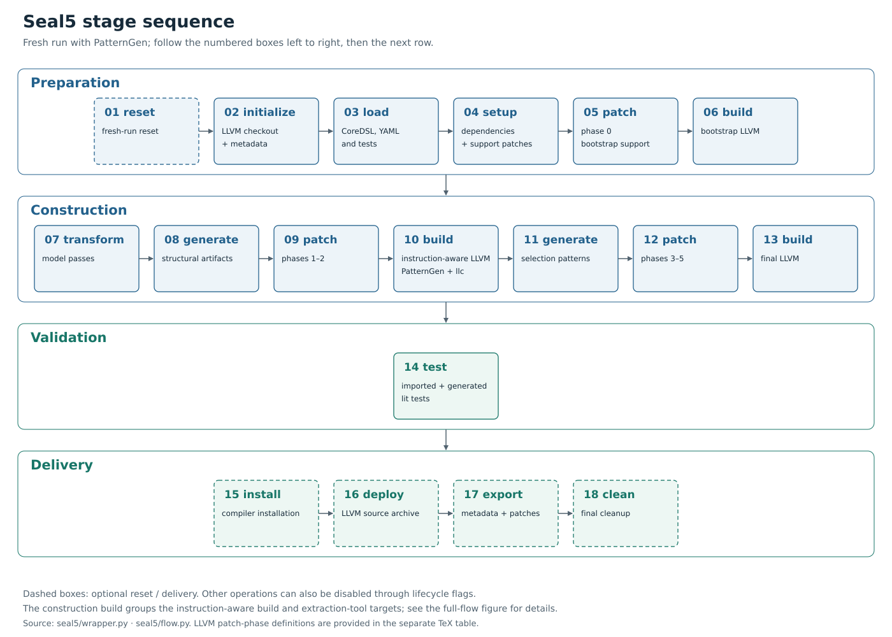
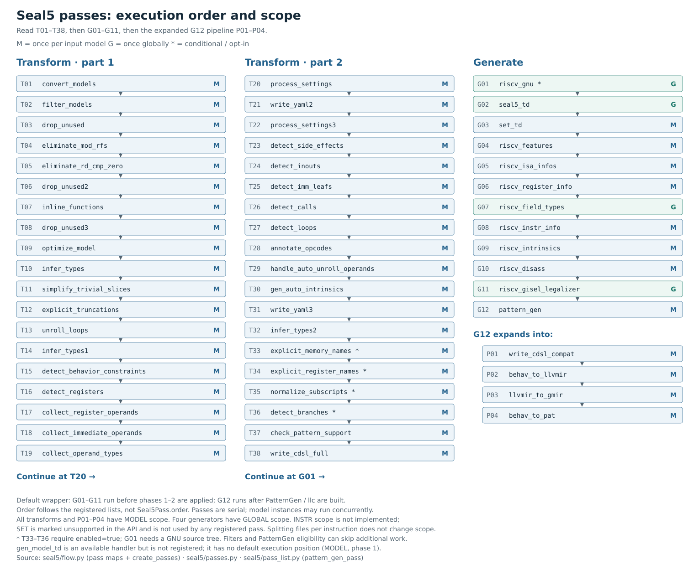
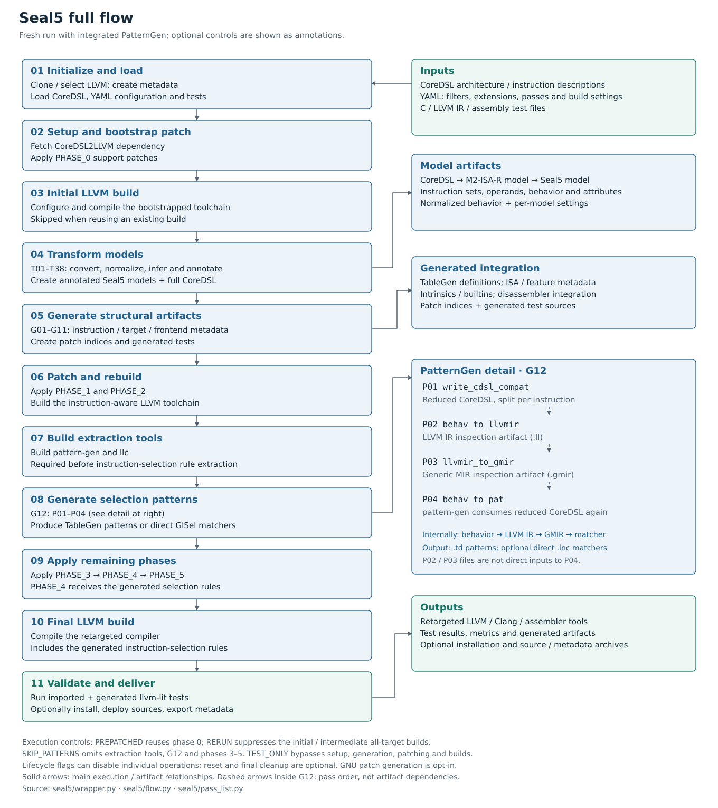

Seal5 architecture diagrams
===========================

These figures describe the registered passes and wrapper flow in this source
checkout. Vector PDFs are suitable for a dissertation; SVGs remain editable.
The pass inventory is best placed on a landscape page or in an appendix.

Stage sequence
--------------

   Sequential stages for a fresh run with PatternGen, grouped by lifecycle role.

:download:`Vector PDF <figures/seal5/01-stages.pdf>`

LLVM patch phases
-----------------

The patch phases are provided as a separate TeX table with an independently
compiled PDF preview. The table lists default assignments for phases zero
through five; these phase numbers are distinct from the lifecycle steps above.
Load ``booktabs`` and ``tabularx`` and include the TeX file with ``\input``.

:download:`TeX table <figures/seal5/01-patch-phases.tex>` |
:download:`PDF preview <figures/seal5/01-patch-phases.pdf>`

Pass order and scope
--------------------

   Registered pass order and scope. M denotes per-model execution; G denotes
   global execution. The final generation pass expands into four nested passes.

:download:`Vector PDF <figures/seal5/02-passes.pdf>` |
:download:`Pass catalog (CSV) <figures/seal5/passes.csv>`

Full compiler-generation flow
-----------------------------

   Fresh-run flow with integrated PatternGen. The inset distinguishes pass order
   from artifact dependencies during pattern extraction.

:download:`Vector PDF <figures/seal5/03-full-flow.pdf>`

Reproduction and source provenance
---------------------------------

:download:`Figure notes, captions and LaTeX examples <figures/seal5/README.md>`
include execution controls, inactive handlers, and regeneration instructions.
The :download:`generator <figures/seal5/generate.py>` reads the pass registration
lists from Python syntax trees without importing Seal5 or running any builds.
The :download:`source manifest <figures/seal5/sources.json>` records fingerprints
of the implementation files used for these figures.
